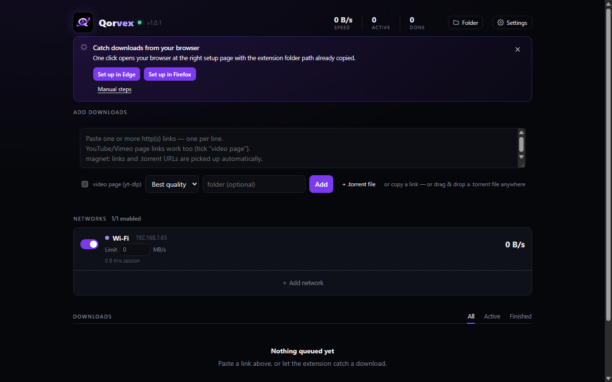

<div align="center">


# Qorvex

**One download. Every network at once.**

A download manager that grabs links and videos straight from your browser —
then downloads each file over **all of your internet connections simultaneously**.

[](https://github.com/PagalSarthak/qorvex/actions)
[](#download)
[](LICENSE)
[](https://www.python.org)

`Windows exe` · `macOS .app` · `Linux binary` · `browser extension` · `72 checksum-verified tests`

</div>

---

<video src="docs/demo.mp4" controls muted loop width="100%" poster="docs/screenshot.png"></video>


## Why

Your connection has more than one road in — Wi-Fi, Ethernet, a USB tether, a phone hotspot.
Normal download managers use one. Qorvex splits every file into chunks and pulls them **through
every interface you enable at the same time**, so faster links carry more of the work. And like
IDM, it quietly takes over your browser downloads — Chrome, Edge, Brave, Firefox.

```
 Browser extension ──► Qorvex (local, 127.0.0.1) ──► Wi-Fi ┐
  • takes over downloads            • splits file into     ├─► one file on disk
  • right-click "Download with…"      chunks               │
  • hover-button on videos           • each chunk goes out    Ethernet / USB tether /
  • clipboard link catcher             over a chosen network  phone hotspot ┘
```

## Highlights

| | |
|---|---|
| 🌐 **Browser capture** | Takes over downloads like IDM — with a size filter and an on/off switch you control |
| 🚀 **True bonding** | Chunks streamed over every enabled interface at once; verified by checksum in tests |
| 🎬 **Video sites** | YouTube & co. via yt-dlp — resolved once per network so IP-locked media still bonds |
| 🧲 **Torrents** | Magnet links, `.torrent` files, drag & drop — powered by libtorrent |
| 📋 **Clipboard catcher** | Copy a link → one-click banner offers the download |
| 🖥 **Desktop app** | Real window on every OS, **system tray** with Pause/Resume-all, close-to-tray, finish notifications |
| 📁 **Categories** | `video/ audio/ documents/ archives/ programs/` — automatic |
| 🔁 **Resilient resumes** | Pause/resume survives restarts; refuses to resume a changed remote file |
| 🔐 **Local & private** | Listens on `127.0.0.1` only. No accounts, no telemetry, no server — nothing leaves your machine |

<details>
<summary><b>Every feature, mapped to its inspiration</b></summary>

| IDM-style (browser) | Multi-network (bonding) |
|---|---|
| Takes over browser downloads | Splits each file into chunks across interfaces |
| Hover button on any video | Per-network connection count and speed caps |
| Right-click → Download with Qorvex | Global speed limit |
| Clipboard link catcher | Per-network enable/disable, live |
| Category folders (video/audio/docs/…) | Bonding verified by checksum in tests |
| Pause / resume / retry / cancel | Per-network yt-dlp resolution for IP-locked media |
| Batch add (paste many links) | Torrents via libtorrent: magnet links and `.torrent` files |
| Start at login, system tray with menu | Network failure isolation + automatic recovery |
| Open / reveal finished files | IPv4 source-IP + device binding |
| Close-to-tray, finish notifications | Resume validated by URL, size, ETag, Last-Modified |

</details>

## Download

Grab a build from [**Releases**](https://github.com/PagalSarthak/qorvex/releases) — or build it yourself
in one command (see [Building](#building)). No Python needed to run: it's one file.

| Platform | File | Notes |
|---|---|---|
| **Windows (installer)** | `Qorvex-1.0.1-setup.exe` | Full setup: Start Menu + desktop shortcuts, optional start-on-login, real uninstaller in Settings → Apps |
| **Windows (portable)** | `qorvex.exe` | Double-click — opens as a desktop window (WebView2, built into Windows 10/11) |
| **macOS** | `Qorvex.app` | Drag into Applications. First launch: right-click → **Open** (Gatekeeper, unnotarized) |
| **Linux** | `qorvex` | `chmod +x qorvex && ./qorvex`. Uses Qt or GTK webkit for the window; browser mode needs nothing |
| Browser extension | **[Edge Add-ons store](https://microsoftedge.microsoft.com/addons/detail/qorvex/agpmffhlcidmmjoigmondmefoclcaecn)** · `chrome/` · `firefox/` | The app's setup card links straight to the store for Edge; other browsers get the one-click unpacked flow |

**ffmpeg is bundled** in every build — YouTube video+audio merge into one file out of the box.
Override with the `QORVEX_FFMPEG` environment variable if you want a different binary.

## Run from source

```bash
pip install psutil pywebview pystray
pip install -U "yt-dlp[default]"    # only for YouTube / video-site downloads
pip install -U libtorrent           # only for magnet: / .torrent downloads

python -m qorvex serve              # opens as a desktop window
```

No `pywebview`? The dashboard still works — it just opens in your browser at
`http://127.0.0.1:6805`. `python -m qorvex serve --no-window` forces browser mode.

Handy commands:

```bash
python -m qorvex add https://example.com/file.iso
python -m qorvex add https://youtu.be/... --media --quality 720
python -m qorvex nets               # list detected interfaces
python -m qorvex log -n 200         # tail the log
python -m qorvex open               # open the download folder
python -m qorvex autostart on|off|status
```

`qorvex --port 7000` is shorthand for `qorvex serve --port 7000`.

<details>
<summary><b>All CLI commands</b></summary>

```bash
qorvex serve [--port N] [--dir D] [--no-window] [--no-open] [--console]
             [--network NAME=IP]... [--loopback] [--max-active N]
             [--cookies-from-browser firefox|chrome|edge|...]
qorvex add URL... [--media] [--quality best|1080|720|480|360|audio] [--torrent] [--dir D]
qorvex nets | log [-n N] | open | extension | settings | autostart on|off|status
```

</details>

## How it works

- Probes the URL, splits the file into 1–8 MB chunks in a shared queue; each enabled network
  runs N connections (default 4) pulling chunks, so faster networks carry more. Sockets are
  pinned to each interface (`SO_BINDTODEVICE` on Linux, `IP_BOUND_IF` on macOS, source-IP bind
  elsewhere).
- Idle connections split the tail of the largest in-flight chunk, so no worker sits idle at the end.
- Every ranged response is verified: status must be `206`, `Content-Range` must match the request.
- A network that fails repeatedly is dropped for that job; **retry** clears it — replug a cable or
  reconnect a VPN and it rejoins without restarting Qorvex. If every network is disabled the job
  pauses instead of spinning.
- Filenames are sanitized and checked against Windows reserved names (`CON`, `NUL`, `COM1`, …).

<details>
<summary><b>Video sites, torrents and the security model</b></summary>

### Video sites

Players like YouTube use `blob:` streams, so the extension sends the **page URL** to Qorvex, which
resolves it with **yt-dlp**. Those direct links are usually locked to the requesting IP, so Qorvex
resolves **once per network** and each network downloads with its own link. Video and audio arrive
as two parts and are merged with **ffmpeg** (bundled in every build). The **Deno JavaScript
runtime is bundled too** — yt-dlp needs it to solve YouTube's bot challenges, so there is no
extra setup. If YouTube still says *"Sign in to confirm you're not a bot"*, set
Settings → Engine → **Video cookies from browser** to the browser you are signed in with.
Streaming-only formats (HLS/DASH
playlists) are rejected up front with a clear error instead of failing late.

### Torrents

Paste a `magnet:` link or `.torrent` URL, drop a `.torrent` file anywhere on the dashboard, or use
the *+ .torrent file* picker. libtorrent handles DHT, trackers, peers and pieces; outgoing peer
connections bind to every enabled network's IP, so peer traffic spreads across your interfaces —
and each peer's bytes are attributed to the network it actually used, feeding the per-network
stats. Seeding is controlled by *Seed torrents until ratio* (`0` = stop when complete).

### Security model

The server listens on **127.0.0.1 only** and:

- rejects any request whose `Host` is not `127.0.0.1`/`localhost` (blocks DNS rebinding),
- rejects web-page `Origin`s; only its own UI and `chrome-extension://`/`moz-extension://` are allowed,
- requires `Content-Type: application/json` for POST, so a cross-site HTML form cannot drive the API,
- optionally requires a token for extension-origin requests,
- accepts only `http(s)` URLs; opens/reveals only paths under the download, state or extension folder,
- caps request bodies at 1 MB.

Anything already running on your PC can still call the API, as with most local download managers.
The UI ships no inline third-party scripts and sets `nosniff`/`no-referrer`.

</details>

## Building

| Platform | Command | Output |
|---|---|---|
| Windows | `build.bat` | `dist\qorvex.exe` |
| Linux / macOS | `./build.sh` | `dist/qorvex` · `dist/qorvex.app` on macOS |
| Any OS, no tools installed | push → **Actions → Build Qorvex** | Windows exe, macOS .app, Linux binary + extension |

CI runs the full test suite on Windows and Linux runners, then builds all three platforms.

## Tests

```bash
python -m pytest -q
```

**72 tests**, most checksum-verified against a real ranged HTTP server: bonding across two
loopback "interfaces", networks disabled mid-flight, pause/resume across restarts, wrong
`Content-Range` rejection, no-Range fallback, filename collisions and Windows reserved names,
per-network yt-dlp resolution with IP-locked URLs, HLS rejection, torrent magnet/`.torrent`
handling with per-peer network attribution, the full HTTP security surface, and more. Torrent
tests use a fake libtorrent session, so they run offline.

## Honest limits

- **Real multi-NIC speed-up needs real hardware.** Each interface must have its own uplink; Wi-Fi
  and Ethernet on the same router usually share one WAN and won't add bandwidth. Some servers
  also rate-limit per IP.
- YouTube resolution depends on yt-dlp, a JS runtime and your cookies; the offline suite uses a
  fake resolver.
- IPv4 and `http(s)` only. No HLS/DASH muxing, no proxy support.
- If the ffmpeg download is unavailable at build time, the app still builds and falls back to a
  system ffmpeg (`PATH` or the `QORVEX_FFMPEG` variable).
- Torrents bond on outgoing connections; incoming peers arrive on one listen port, and torrent
  jobs aren't persisted across restarts (finished files are).
- The Linux desktop window needs Qt (`pywebview[qt]`, installed by `build.sh`) or GTK webkit; the
  browser UI works everywhere without any of that.

## Layout

```
qorvex/
  config.py      settings spec, validation, atomic JSON store
  engine.py      networks, bound sockets, chunk queue, workers, resume, scheduler
  media.py       per-network yt-dlp resolution, hidden parts, ffmpeg merge
  torrent.py     magnet / .torrent downloads via a shared libtorrent session
  server.py      local HTTP API + UI host, security guards
  app.py         wiring: settings, engine, clipboard, autostart, lifecycle
  tray.py        system tray icon, close-to-tray, finish notifications
  ui.html        dashboard (single file, no build step)
  clipboard.py   platform clipboard readers + watcher
  autostart.py   HKCU Run / XDG autostart / LaunchAgent
  system.py      open/reveal files, clipboard helpers, app id
  __main__.py    CLI
extension/
  src/           one source for both browsers
  chrome/        built MV3
  firefox/       built MV2
tests/           pytest suite
docs/            store assets and screenshots
```

---

<div align="center">
<i>Qorvex is free software under the <a href="LICENSE">MIT license</a>. Built for people whose internet has more than one door.</i>
</div>
